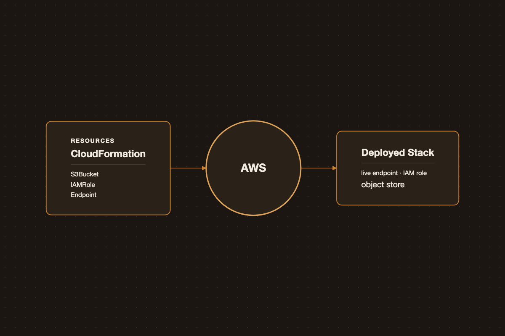

# Deploying a Machine Learning Project with AWS CloudFormation

{.post-banner fig-alt="Deploying a Machine Learning Project with AWS CloudFormation"}

Clicking through the AWS console to deploy a model works once. Infrastructure as code makes it reproducible: the same template spins up dev, staging, and prod, and can be reviewed and versioned like any other code.

## What Is Infrastructure as Code?

Infrastructure as Code (IaC) means describing infrastructure - networks, IAM roles, compute, storage - in a text file instead of provisioning it by hand. That file is checked into version control, reviewed in a pull request, and applied by a tool that reconciles the target environment to match it. Three properties fall out of that:

- **Reproducibility** - the same definition produces the same stack in dev, staging, and prod.
- **Auditability** - changes to infrastructure show up as diffs, not as an entry in someone's shell history.
- **Idempotency** - re-applying a template that already matches reality is a no-op; the tool only acts on the delta.

IaC tools split along one main axis: **declarative vs. imperative**. Declarative tools (CloudFormation, Terraform, ARM/Bicep) describe the desired end state and let the engine figure out the create/update/delete sequence. Imperative tools (a hand-rolled boto3 script, a bash script wrapping the AWS CLI) describe the steps to get there. Pulumi and CDK sit in between: you write real code in Python or TypeScript, but that code builds a desired-state model that an engine diffs and applies, so they behave declaratively. Declarative is the norm for cloud infrastructure because the engine can diff current vs. desired state and tell you what will change *before* it changes it.

CloudFormation is AWS's own declarative engine: no install, no state file to manage, and IAM governs who can deploy what. The trade-offs are that it only speaks AWS and new features don't always arrive on launch day (AWS keeps a public [coverage roadmap](https://github.com/aws-cloudformation/cloudformation-coverage-roadmap) for the gaps).

## CloudFormation vs. Terraform vs. Azure ARM/Bicep

| | **CloudFormation** | **Terraform** | **Azure ARM / Bicep** |
|---|---|---|---|
| Scope | AWS only | Multi-cloud (AWS, Azure, GCP, plus thousands of registry providers) | Azure only |
| Language | YAML/JSON | HCL | JSON (ARM) or Bicep (DSL that compiles to ARM) |
| State | Managed by AWS, no local state file | State file (local or remote backend: S3, HCP Terraform) that you must protect and lock | Managed by Azure |
| Drift detection | Built-in (`detect-stack-drift`, supported resource types only) | `terraform plan` refreshes and shows drift, but only for resources in state | No native drift detection; scheduled what-if runs or deployment stacks with deny settings |
| Change preview | Change sets (`deploy --no-execute-changeset` to review before applying) | `terraform plan` | What-if operations |
| Ecosystem | Native AWS support, SAM for serverless | Largest ecosystem, most third-party modules, works across clouds | Native Azure support, best for Azure-centric shops |
| Best fit | AWS-only teams that want zero extra tooling and tight IAM integration | Teams running multi-cloud or hybrid infra, or who want one tool for everything | Azure-only teams already inside the Microsoft stack |

For an AWS-only ML deployment like the one below, CloudFormation removes a moving part: there's no state file to lose or corrupt, and permissions are governed by the same IAM you already use for everything else in the account. Terraform earns its keep once you're provisioning outside AWS too (e.g., a Snowflake warehouse or a GCP BigQuery dataset alongside your SageMaker endpoint) - at the cost of managing state yourself. Azure's tools are the equivalent choice if your ML platform lives in Azure ML instead of SageMaker.

## A Minimal Stack

The serving stack is four resources: an IAM role SageMaker assumes to pull the image and the artifact, a Model that pairs the two, an EndpointConfig that picks the instance type, and the Endpoint itself. The artifact bucket lives outside the stack on purpose. If the stack created the bucket, it would be empty when the Model tries to load `model.tar.gz` from it, and the deploy would roll back.

```yaml
Parameters:
  ImageUri:
    Type: String
  ModelDataUrl:
    Type: String
    Description: s3://<bucket>/<prefix>/model.tar.gz, uploaded before deploy
  ModelBucketName:
    Type: String
  InstanceType:
    Type: String
    Default: ml.m5.large

Resources:
  SageMakerExecutionRole:
    Type: AWS::IAM::Role
    Properties:
      AssumeRolePolicyDocument:
        Version: "2012-10-17"
        Statement:
          - Effect: Allow
            Principal:
              Service: sagemaker.amazonaws.com
            Action: sts:AssumeRole
      Policies:
        - PolicyName: model-hosting
          PolicyDocument:
            Version: "2012-10-17"
            Statement:
              - Effect: Allow
                Action: s3:GetObject
                Resource: !Sub "arn:${AWS::Partition}:s3:::${ModelBucketName}/*"
              - Effect: Allow
                Action:
                  - ecr:GetAuthorizationToken
                  - ecr:BatchGetImage
                  - ecr:GetDownloadUrlForLayer
                  - ecr:BatchCheckLayerAvailability
                Resource: "*"
              - Effect: Allow
                Action:
                  - logs:CreateLogGroup
                  - logs:CreateLogStream
                  - logs:PutLogEvents
                  - cloudwatch:PutMetricData
                Resource: "*"

  Model:
    Type: AWS::SageMaker::Model
    Properties:
      ExecutionRoleArn: !GetAtt SageMakerExecutionRole.Arn
      PrimaryContainer:
        Image: !Ref ImageUri
        ModelDataUrl: !Ref ModelDataUrl

  EndpointConfig:
    Type: AWS::SageMaker::EndpointConfig
    Properties:
      ProductionVariants:
        - ModelName: !GetAtt Model.ModelName
          VariantName: AllTraffic
          InitialInstanceCount: 1
          InstanceType: !Ref InstanceType

  Endpoint:
    Type: AWS::SageMaker::Endpoint
    Properties:
      EndpointConfigName: !GetAtt EndpointConfig.EndpointConfigName

Outputs:
  EndpointName:
    Value: !GetAtt Endpoint.EndpointName
```

The role is scoped to what an endpoint actually does: read one bucket, pull from ECR, write logs and metrics. `AmazonSageMakerFullAccess` is the tempting shortcut, but it only grants `s3:GetObject` on buckets with "sagemaker" in the name (or objects tagged `SageMaker=true`), and it grants far more SageMaker permissions than an endpoint needs.

`ImageUri` is either an AWS Deep Learning Container or SageMaker framework image, or your own image in ECR. `model.tar.gz` has to match the layout that container expects, so check the image's docs before packaging.

## Deploying the Stack

Upload the artifact first, then deploy:

```bash
aws s3 cp model.tar.gz s3://my-model-bucket/v1/model.tar.gz

aws cloudformation deploy \
  --template-file stack.yaml \
  --stack-name ml-inference-dev \
  --capabilities CAPABILITY_IAM \
  --parameter-overrides \
      ImageUri=123456789012.dkr.ecr.us-east-1.amazonaws.com/my-model:1.0 \
      ModelDataUrl=s3://my-model-bucket/v1/model.tar.gz \
      ModelBucketName=my-model-bucket
```

`CAPABILITY_IAM` is enough because the role has no explicit `RoleName`. Once the stack reaches `CREATE_COMPLETE`, check that the endpoint answers:

```bash
aws cloudformation describe-stacks --stack-name ml-inference-dev \
  --query "Stacks[0].Outputs"

aws sagemaker-runtime invoke-endpoint \
  --endpoint-name <EndpointName from outputs> \
  --content-type application/json \
  --body '{"inputs": [[1.0, 2.0, 3.0]]}' \
  --cli-binary-format raw-in-base64-out \
  out.json && cat out.json
```

The request body depends on the container's input handler, so adjust it to whatever your model server parses.

## Tips

- Deploy the same file once per environment: `--stack-name ml-inference-dev` with `InstanceType=ml.m5.large`, `--stack-name ml-inference-prod` with something bigger. No `Conditions` blocks branching on an `Env` parameter.
- Shipping a new model is a new `ModelDataUrl` (or `ImageUri`). Because no resource names are hard-coded, CloudFormation replaces the Model and EndpointConfig and updates the Endpoint in place to the new config.
- Tear down with `aws cloudformation delete-stack --stack-name ml-inference-dev` when you're done. An idle `ml.m5.large` endpoint still bills every hour it's up, and since the artifact bucket lives outside this stack, deleting the endpoint never touches your model files.

CloudFormation won't replace judgment about architecture, but it turns "how did we deploy this?" from a Slack archaeology exercise into a file you can read.

## SAM vs. Plain CloudFormation

AWS SAM (Serverless Application Model) isn't a separate deployment engine - it's a CloudFormation *transform* (`Transform: AWS::Serverless-2016-10-31`). A SAM template gets expanded into a full CloudFormation template at deploy time, plus you get a CLI built around a Lambda-centric workflow: `sam build`, `sam local invoke`, `sam deploy --guided`.

| | Plain CloudFormation | SAM |
|---|---|---|
| Best fit | Any AWS resource type - SageMaker, S3, IAM, VPC, RDS, whatever the stack needs | Serverless apps: Lambda, API Gateway, Step Functions, DynamoDB |
| Template verbosity | Full resource properties every time (IAM permissions, API Gateway integrations spelled out) | Shorthand types (`AWS::Serverless::Function`, `::Api`) expand that boilerplate for you |
| Local testing | None in the CloudFormation CLI (the SAM CLI can still `sam local invoke` a plain `AWS::Lambda::Function`) | `sam local invoke` / `sam local start-api` run your Lambda in a local Docker container before it ever touches AWS |
| Packaging | Manual `aws cloudformation package` to zip and upload code to S3 | `sam build` handles dependency installation and packaging |
| Underlying engine | CloudFormation | Also CloudFormation - SAM templates are valid CloudFormation with one added `Transform` line |

For the SageMaker stack above, plain CloudFormation is the right call: SAM's shorthand only covers serverless resource types, and `AWS::SageMaker::Model`/`EndpointConfig`/`Endpoint` have no SAM equivalent to shrink. SAM earns its keep the moment the inference layer *is* a Lambda function - e.g., a lightweight CPU model invoked behind API Gateway, or a Lambda that calls out to a SageMaker endpoint. In that case the boilerplate SAM strips away (API Gateway wiring, Lambda execution roles and permissions) is exactly the boilerplate that pattern generates, and the local dev loop (`sam local invoke`) comes with the SAM CLI, which is reason enough to install it. Nothing stops a single template from mixing both - SAM resources alongside raw CloudFormation ones - since a SAM template is just CloudFormation with a transform applied.

### Quick SAM How-To

```bash
# 1. Install the CLI
brew install aws-sam-cli   # or the pip/binary installer

# 2. Scaffold a project (template.yaml + function code)
sam init
```

A minimal `template.yaml` for a Lambda behind API Gateway:

```yaml
Transform: AWS::Serverless-2016-10-31
Resources:
  InferenceFunction:
    Type: AWS::Serverless::Function
    Properties:
      CodeUri: src/
      Handler: app.handler
      Runtime: python3.12
      MemorySize: 512
      Timeout: 30
      Events:
        Api:
          Type: Api
          Properties:
            Path: /predict
            Method: post
```

```bash
# 3. Install dependencies and stage the deployment artifact
sam build

# 4. Test locally, in a Docker container that mimics the Lambda runtime
sam local invoke InferenceFunction --event event.json

# 5. First deploy: walks through stack name/region/confirmation prompts
#    and saves the answers to samconfig.toml
sam deploy --guided

# Every deploy after that is just:
sam deploy
```

The rule of thumb: reach for SAM when the deployable unit is a Lambda function and you want a local test loop before every deploy; stay with plain CloudFormation when the stack is built from broader AWS resource types that SAM's transform doesn't shorten anyway.
