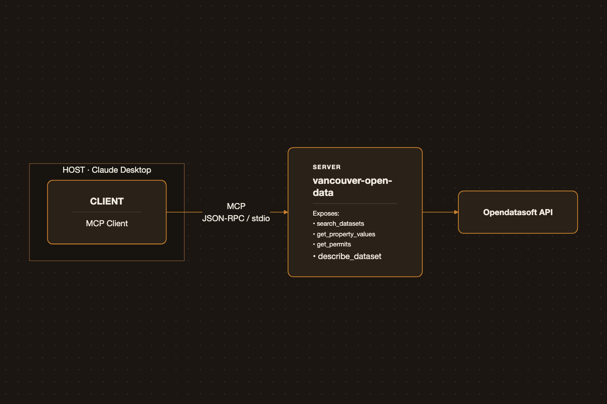

# Building an MCP Server for Vancouver's Open Data

{.post-banner fig-alt="Building an MCP Server for Vancouver's Open Data"}

The City of Vancouver publishes about 200 public datasets (property assessments, building permits, public art, parking meters) through a REST API. Wiring that API up as an MCP server means any MCP-compatible LLM client can query it directly, with natural language instead of hand-written filter syntax.

## Why MCP Fits Open Data

The Model Context Protocol standardizes how an LLM discovers and calls external tools, and open data portals fit it well. The data is already structured: each dataset has a stable schema, so tool inputs and outputs map cleanly to typed function signatures.

Discovery is the hard part. Most people don't know a dataset called `issued-building-permits` exists, let alone its field names. An MCP server can expose search as a tool, so the model finds the dataset, not the user.

There is also no auth to deal with. Vancouver's portal is public and read-only, so the server doesn't manage credentials or write access. It's a thin translation layer.

## MCP Building Blocks: Hosts, Clients, Servers, Transports

Before wiring up Vancouver's data, here is what "an MCP server" actually plugs into. The spec defines a handful of distinct pieces:

- **Host**: The user-facing application (Claude Desktop, an IDE, a custom agent). It owns the LLM conversation and decides which servers to connect to.
- **Client**: Lives inside the host, maintains a 1:1 connection to a single server, and handles the JSON-RPC message plumbing. A host with three servers configured runs three clients internally.
- **Server**: The process you actually write. It advertises capabilities and responds to client requests. This post's `vancouver-open-data` server is one of these.
- **Tools**: Model-invoked functions with a name, description, and JSON-schema input (`search_datasets`, `get_property_values` below). The LLM decides when to call them based on the conversation.
- **Resources**: Addressable, read-only data the *host application* can pull in (a dataset schema, a file, a config blob) without going through the model's tool-calling loop. The client still sends a `resources/read` request, but no model turn is spent deciding to fetch it.
- **Prompts**: Reusable, user-triggered templates (e.g., a "/summarize-permits" slash command) that expand into a preset message, as opposed to tools which the model chooses on its own.

For the Vancouver server, only **tools** are used today. The "Next Steps" section below is really about starting to use **resources** for the schema-lookup use case, since `describe_dataset` is a better fit as something the client fetches directly than as a model-invoked round trip.

### Transports

Transport is the channel the client and server exchange JSON-RPC messages over. MCP currently defines two:

| Transport | How it works | When to use it |
|---|---|---|
| **stdio** | Host spawns the server as a local subprocess; messages go over stdin/stdout | Local tools, CLI integrations, anything running on the same machine as the host, with no network or auth |
| **Streamable HTTP** | Server runs as a standalone HTTP endpoint; client POSTs JSON-RPC and can receive streamed responses via SSE | Remote/shared servers, multi-client access, anything needing auth headers or running behind a real deployment |

(An older HTTP+SSE transport with two separate endpoints predates Streamable HTTP and is now considered legacy.)

The Vancouver server uses **stdio** (`mcp.run(transport="stdio")` in the code below) because it's a single-user, local integration registered directly in Claude Desktop's config. There's no case for standing up an HTTP server just to query a public, read-only API from one machine.

## Vancouver's Open Data API

Vancouver's portal (`opendata.vancouver.ca`) runs on Opendatasoft, exposed through a REST API at:

```
https://opendata.vancouver.ca/api/explore/v2.1/catalog/datasets/{dataset_id}/records
```

Each dataset accepts `where` (an SQL-like filter expression), `select` (to trim the fields returned), `limit` (capped at 100), `offset`, and `order_by` query params, and returns JSON records with a consistent `results` envelope. A handful of datasets cover most useful queries:

| Dataset ID | Contents |
|---|---|
| `property-tax-report` | Assessed values by address, year, tax levies |
| `issued-building-permits` | Permit type, address, project value, issue date |
| `public-art` | Artwork title, artist, location, install year |

## Designing the MCP Tools

Rather than exposing the raw API 1:1, I mapped it to a small set of task-shaped tools plus a discovery tool:

- `search_datasets(query)`: keyword search over the catalog, returns dataset IDs and descriptions.
- `get_property_values(civic_number, street_name, year)`: assessed value lookup for one address.
- `get_permits(address, since)`: building permits issued at an address, optionally since a date.
- `describe_dataset(dataset_id)`: returns field names and types, so the model can build valid `where` filters for datasets it hasn't seen before.

Keeping tools narrow (rather than one generic `query(dataset, filter)` tool) makes the model's job easier. It doesn't need to guess field names, and each tool is the one place where its inputs get checked and escaped.

## Implementation

The server is built with the Python MCP SDK's `MCPServer` (called `FastMCP` before v2), talking to the Opendatasoft API over `httpx`. The code targets `mcp` 2.x; on 1.x the import is `from mcp.server.fastmcp import FastMCP` and the rest is the same.

```python
from mcp.server.mcpserver import MCPServer
import httpx

mcp = MCPServer("vancouver-open-data")
BASE_URL = "https://opendata.vancouver.ca/api/explore/v2.1/catalog/datasets"


def quote(value: str) -> str:
    """Escape a value for use inside an ODSQL double-quoted string."""
    return value.replace("\\", "\\\\").replace('"', '\\"')


async def fetch(path: str, **params) -> dict:
    async with httpx.AsyncClient() as client:
        resp = await client.get(f"{BASE_URL}{path}", params=params)
        resp.raise_for_status()
        return resp.json()


@mcp.tool()
async def search_datasets(query: str, limit: int = 10) -> list[dict]:
    """Search the City of Vancouver's open data catalog by keyword."""
    data = await fetch("", where=f'search("{quote(query)}")', limit=min(limit, 100))
    return [
        {"id": d["dataset_id"], "title": d["metas"]["default"]["title"]}
        for d in data["results"]
    ]


@mcp.tool()
async def describe_dataset(dataset_id: str) -> list[dict]:
    """List a dataset's field names and types, to build valid filters."""
    data = await fetch(f"/{dataset_id}")
    return [{"name": f["name"], "type": f["type"]} for f in data["fields"]]


@mcp.tool()
async def get_property_values(
    civic_number: str, street_name: str, year: int | None = None
) -> list[dict]:
    """Assessed land and building values for one address, newest year first.

    street_name uses the tax roll's short form, e.g. "MAIN ST".
    """
    where = (
        f'to_civic_number = "{quote(civic_number)}" '
        f'and street_name = "{quote(street_name.upper())}"'
    )
    if year:
        where += f' and tax_assessment_year = "{year}"'
    data = await fetch(
        "/property-tax-report/records",
        where=where,
        order_by="tax_assessment_year desc",
        select="tax_assessment_year,current_land_value,current_improvement_value",
        limit=20,
    )
    return data["results"]


@mcp.tool()
async def get_permits(address: str, since: str | None = None, limit: int = 20) -> list[dict]:
    """Building permits issued at an address like "3771 MAIN STREET".

    since is an ISO date (YYYY-MM-DD).
    """
    where = f'address like "{quote(address)}"'
    if since:
        where += f" and issuedate >= date'{since}'"
    data = await fetch(
        "/issued-building-permits/records",
        where=where,
        order_by="issuedate desc",
        select="permitnumber,issuedate,typeofwork,projectvalue,projectdescription",
        limit=min(limit, 100),
    )
    return data["results"]


if __name__ == "__main__":
    mcp.run(transport="stdio")
```

Every value the model passes in goes through `quote()` before it lands in a `where` clause, so an address containing a `"` can't break out of the string literal and rewrite the filter.

The address lookup is less obvious than it looks. The tax roll splits an address into `to_civic_number` (`3771`) and `street_name` (`MAIN ST`), so `get_property_values` takes the two parts separately. Matching a full string like `"3771 Main St"` against `street_name` returns zero rows.

Registering the server with Claude Desktop takes a short entry in `claude_desktop_config.json`:

```json
{
  "mcpServers": {
    "vancouver-open-data": {
      "command": "uv",
      "args": ["run", "--with", "mcp", "--with", "httpx", "/path/to/server.py"]
    }
  }
}
```

The host spawns the process itself over stdio, so there is nothing to host for local use.

## Python vs TypeScript: Same Server, Two SDKs

MCP has first-party SDKs in both languages. Here is the same `search_datasets` tool in TypeScript with `@modelcontextprotocol/server` (v2; the v1 package was `@modelcontextprotocol/sdk`):

```typescript
import { McpServer } from "@modelcontextprotocol/server";
import { StdioServerTransport } from "@modelcontextprotocol/server/stdio";
import { z } from "zod";

const server = new McpServer({ name: "vancouver-open-data", version: "1.0.0" });
const BASE_URL = "https://opendata.vancouver.ca/api/explore/v2.1/catalog/datasets";

server.registerTool(
  "search_datasets",
  {
    description: "Search the City of Vancouver's open data catalog by keyword.",
    inputSchema: z.object({ query: z.string(), limit: z.number().max(100).default(10) }),
  },
  async ({ query, limit }) => {
    const url = new URL(BASE_URL);
    url.searchParams.set("where", `search("${query.replaceAll('"', '\\"')}")`);
    url.searchParams.set("limit", String(limit));
    const res = await fetch(url);
    if (!res.ok) throw new Error(`ODS ${res.status}: ${await res.text()}`);
    const { results } = await res.json();
    const datasets = results.map((d: any) => ({
      id: d.dataset_id,
      title: d.metas.default.title,
    }));
    return { content: [{ type: "text", text: JSON.stringify(datasets) }] };
  }
);

await server.connect(new StdioServerTransport());
```

It needs `"type": "module"` in `package.json` for the top-level `await`. The `res.ok` check matters more than it looks: the API rejects `limit` above 100 with an error body, and without the check `results` is `undefined` and the `.map` call fails with an unhelpful `TypeError`.

Writing the same tool twice made the differences easy to see:

| | Python (`MCPServer`) | TypeScript (`McpServer`) |
|---|---|---|
| Tool registration | `@mcp.tool()` decorator on a plain function | `server.registerTool(name, config, handler)` call |
| Input validation | Python type hints, inferred into JSON schema and validated by Pydantic | Explicit `zod` schema, more verbose but visible at the call site |
| Return value | Return the value directly (list/dict); SDK wraps it | Must hand-wrap into `{ content: [{ type: "text", ... }] }` yourself |
| Docstring vs description | Docstring *is* the tool description shown to the model | `description` is a separate field in the config |
| Async | `async def`, `httpx.AsyncClient` | `async`/`await`, native `fetch` |
| Ecosystem fit | Natural if the data/ML stack (pandas, existing scripts) is already Python | Natural if the server needs to live next to a Node/web backend, or ship as an npm package |

Functionally they're equivalent. Both speak the same JSON-RPC over stdio, so the client on the other end can't tell which language the server is written in. The deciding factor is the language the surrounding project already uses. The decorator and type-hint style is less code for a Python-only script like this one. In TypeScript, one Zod schema gives you runtime validation and typed handler arguments, which pays off in a larger codebase.

## Example Queries and Results

Once connected, a prompt like:

> "What's the assessed value trend for 3771 Main St over the last few years, and were any permits pulled recently?"

resolves into two tool calls, `get_property_values(civic_number="3771", street_name="MAIN ST")` and `get_permits(address="3771 MAIN STREET", since="2023-01-01")`. The first returns seven assessment years (2020 to 2026): land value peaks at $3.5M in 2023 and falls to $1.5M by 2026, while the improvement value climbs from about $12K to $1.9M over the same years. The second returns four alteration permits issued in March 2026. The model turns that into a plain-language answer, and the user never touches the Opendatasoft query syntax.

## Lessons Learned and Next Steps

Schema drift is real. Field names and formats differ across datasets: the tax roll splits an address into `to_civic_number` plus `street_name` (`MAIN ST`), while permits store one `address` string (`3771 MAIN STREET, Vancouver, BC`). That is why `describe_dataset` ended up necessary rather than optional. The model needs a way to check before it guesses.

Narrow tools beat clever ones. An earlier version exposed a single generic `query` tool, and the model wrote malformed `where` clauses often enough that splitting it into task-specific tools was a clear win for reliability.

Caching helps even at demo scale. Iterating on prompts replays the same lookups over and over, so a thin cache in front of `get_property_values` and `get_permits` keeps identical calls from hitting the public API again.

Next: expose dataset schemas as MCP *resources* (not just a tool) so the client can attach a schema to the context directly instead of spending a model turn on a tool call, add a small on-disk cache, and cover a couple more datasets (transit stops, parking meters) once the pattern holds up.
